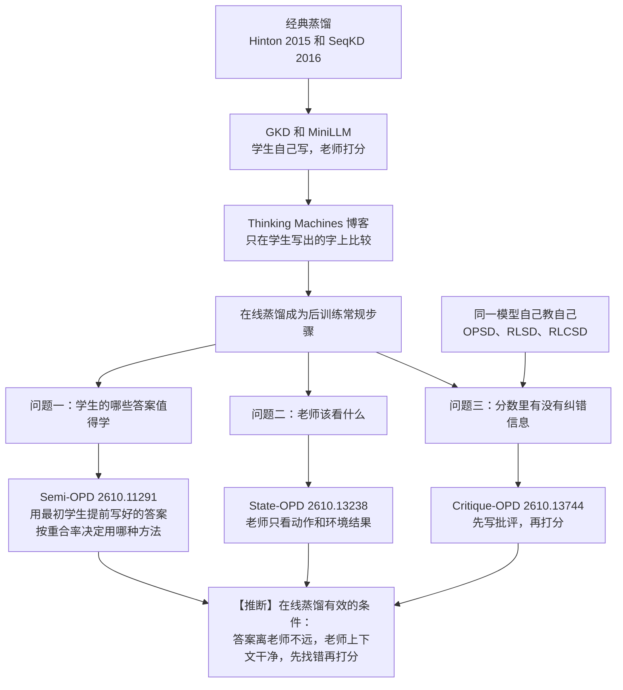

**结论：** 在线蒸馏只在特定条件下有效。2026 年 10 月有三篇论文，各自推翻了它的一个默认做法。

先解释这个词。蒸馏是让小模型（学生）向大模型（老师）学习。在线蒸馏（on-policy distillation，下文简称 OPD）的做法是：学生自己写答案，老师逐字给打分。这里的"字"指 token，也就是模型一次输出的最小文本单位。学生一次完整的作答过程叫一条 rollout。

三篇论文的发现如下：

1. **Semi-OPD**：学生的答案不必每一步都现写。如果学生和老师的想法差得远，就只在训练开始前让学生写一次答案，之后反复用。这样效果更好，训练也更快。
2. **State-OPD**：老师不该看学生之前的思考过程。在多轮交互的智能体任务里，只给老师看"学生做了什么动作、环境返回了什么"，老师的打分更准。
3. **Critique-OPD**：只打分的老师找不到错误。让老师先写一段批评，再打分，分数里才带有纠错信息。"Critique-OPD"是本文的简称，论文的原名是 critique-conditioned self-distillation。

【推断】三篇合起来说明一件事。OPD 的逐字打分只有在三个条件都满足时才有用。第一，学生的答案离老师的习惯不远。第二，老师看到的上下文是干净的。第三，老师真的先找过错误。

---

## 1. 背景：OPD 要解决什么问题

OPD 要解决的是"训练和使用时情况不一致"的问题。

传统蒸馏让学生模仿老师写好的答案。但学生真正使用时，走的是自己的路。训练时没见过自己的错，使用时就不会处理。这个问题叫 exposure bias。

OPD 把顺序反过来。学生自己写答案，老师在学生写的每个 token 上打分。这一方向的代表工作有三项：

- **GKD**（Agarwal et al., ICLR 2024，[arXiv 2306.13649](https://arxiv.org/abs/2306.13649)）：让学生在自己写的答案上学习。论文标题就叫"learning from self-generated mistakes"，意思是从自己犯的错里学。
- **MiniLLM**（Gu et al., ICLR 2024，[arXiv 2306.08543](https://arxiv.org/abs/2306.08543)）：用 reverse KL 做大模型蒸馏。KL 是衡量两个概率分布差多远的指标。reverse KL 是其中一种算法，它更惩罚学生说出老师认为不可能的内容。
- **Thinking Machines 的博客**（Lu & Thinking Machines Lab, 2025，[On-Policy Distillation](https://thinkingmachines.ai/blog/on-policy-distillation)）：把 OPD 推广成模型后训练的常规步骤。它用了一个简化：只在学生实际写出的 token 上，比较老师和学生给这个 token 的概率。

Semi-OPD 论文把这个常用目标写成下面的公式（[2610.11291 §2.1](https://arxiv.org/abs/2610.11291)）：

$$
\mathcal{L}_{OPD}(\theta)=\mathbb{E}_{y\sim\pi_\theta}\Big[\sum_t -A_t\log\pi_\theta(y_t\mid s_t)\Big],\quad
A_t=\log\pi_T(y_t\mid s_t)-\log\pi_\theta(y_t\mid s_t)
$$

公式里的 $A_t$ 当作常数。它的意思很直白：老师比学生更看好的 token，学生就多用；老师不看好的，学生就少用。这相当于一种强化学习（RL），只是每个 token 都有奖励。

这个公式背后有三个默认假设。三篇论文各推翻了一个：

| 默认假设 | 推翻它的论文 |
|---|---|
| 学生的答案越"现写"越好 | Semi-OPD |
| 老师应该看学生的全部历史 | State-OPD |
| 老师和学生的概率差，就能说明错在哪 | Critique-OPD |

---

## 2. 第一种情况：学生和老师想法差太远时，现写的答案反而有害（Semi-OPD）

> Zhao et al., *When Do We Need On-Policy Distillation? Distilling on Offline Student Rollouts Is Often Better*, [arXiv 2610.11291](https://arxiv.org/abs/2610.11291)

### 方法

Semi-OPD 只在训练开始前，让**最初的学生** $\pi_0$ 写一次答案。之后整个训练都反复用这批答案。老师的打分也只算一次。

训练目标和 OPD 完全一样。区别只在于答案的来源。学生自己的概率（也就是 $A_t$）每一步仍用最新参数重算。

论文用一个指标衡量师生想法是否接近。在学生答案的每个位置，取老师最看好的 64 个 token 和学生最看好的 64 个 token，看两组有多少重合。这个指标叫 Overlap@K，下文称"重合率"，默认 K=64。

### 主要结果（均已核对原文）

- 论文测了 17 对师生组合。模型大小从 1.5B 到 235B 参数，来自 Qwen3、DeepSeek-R1-Distill、Nemotron-Cascade-2 三个系列。
- Semi-OPD 在其中 14 对上胜过 OPD。准确率最多高 +13.6%，训练最多快 11.4×。另外 3 对的差距在 0.1%–2.6% 之间。
- 重合率越低，Semi-OPD 的优势越大。两者的相关系数是 r = −0.73。
- 重合率高的例子：Nemotron-Cascade-2 这一对，重合率 89.3%。Semi-OPD 平均得分 74.1，和标准 OPD 持平，比最好的对比方法低 0.7。
- 重合率低的例子：用 Qwen3-4B-Instruct-2507 教 Qwen3-1.7B，重合率 62.5%。标准 OPD 平均得分 26.2，Semi-OPD 是 39.8（表 1，avg@32）。
- 训练成本（表 4，每 100 步所需的 H100 GPU 小时）：同一对组合上，OPD 用 56.8，Semi-OPD 用 5.0。

### 作者的解释

好的蒸馏要同时满足两点。答案要贴近学生的习惯，也要贴近老师的习惯。OPD 只满足了前一点。

师生想法差得远时，OPD 让学生的答案越写越长。训练最后 10 步，OPD 的答案比 Semi-OPD 长 7%–113%。16 对里有 15 对是这样。答案越往后，离老师的习惯越远。老师在这些地方的打分就不可靠。

两个对照实验证实了这一点：

- 把学生的答案换成老师写的答案，效果比 Semi-OPD 差。所以答案仍要来自学生。
- 只用每个答案的前四分之一训练，总 token 数不变，效果明显变差。所以不能靠截短答案解决问题，要覆盖完整的推理过程。

### 适用范围

- 学生本身要够强。如果从未经指令微调的基础模型出发，Semi-OPD 不如 OPD（图 11）。
- 论文还试了"先用老师的答案做一轮监督微调（SFT），再做 Semi-OPD"。结果不如直接做 Semi-OPD。注意，这里的学生已经做过指令微调。

【推断】Semi-OPD 回答的是"学生的哪些答案值得拿来学"。答案要在学生的习惯范围内，也要在老师熟悉的范围内。重合率是检查这一条件的一个便宜办法。

---

## 3. 第二种情况：老师看了学生的旧思考，打分会变差（State-OPD）

> Zhang et al.（Alibaba），*State-OPD: State-Grounded On-Policy Distillation for Multi-Turn Agents*, [arXiv 2610.13238](https://arxiv.org/abs/2610.13238)

### 问题是什么

这篇论文研究多轮交互的智能体。每一轮，学生先思考（记为 $z_t$），再做一个动作（记为 $a_t$）。环境随后返回一个结果（记为 $o_{t+1}$），比如"你打开了抽屉"。

标准 OPD 让老师看学生的完整历史 $h_t$。这段历史里包括学生之前每一轮的思考。

作者定义了一个更干净的"交互状态" $s_t$。它只包含任务、已做的动作和环境返回的结果，**去掉**了学生之前的思考。命题 1 证明：如果动作只通过 $a_t$ 影响环境，那么 $s_t$ 包含了 $h_t$ 中关于环境的全部信息。换句话说，学生的旧思考对了解环境没有帮助，却会进入老师的视野。

### 两个发现

- **学生的旧思考会干扰老师。** 作者在 ALFWorld 上做了测试。ALFWorld 是一个模拟家务任务的文本环境。他们让 Qwen3-32B 老师从同一个局面接着做任务。只看 $s_t$ 时，老师的成功率比看 $h_t$ 时更高。在 Qwen3-4B 学生走到的局面上，这个优势从任务前段的 +0.78 个百分点，涨到后段的 +20.31 个百分点（表 3）。另一个现象是：看 $h_t$ 时，师生之间的 reverse KL 随轮数下降；改看 $s_t$ 后，趋势反过来。作者的解读是：旧思考把老师拉向学生自己的想法。师生差距看起来变小了，但老师的指导也变弱了。
- **当前这一轮的思考决定了动作有多少种可能。** 作者在同一局面下采样 16 次。如果固定思考、只重新生成动作，88.5% 的局面只得到 1 种动作。如果思考和动作一起重新生成，这个比例降到 44.3%。

### 方法

1. **老师只看状态**：学生仍然看完整历史 $h_t$ 来写答案。老师只看 $s_t$ 来打分。
2. **在学生拿不准的地方多采样**：作者用 token 熵衡量学生有多拿不准。熵越高，学生越犹豫。方法会挑出熵高的局面，在那里多生成几份完整回答。总计算量和"每题生成 4 份"的基线大致相同（$\beta=2$，每个选中的局面多生成 6 份）。

### 主要结果（均已核对原文）

- 测试用了三个环境：ALFWorld、ScienceWorld、WebShop。老师是 Qwen3-32B。
- Qwen3-4B 学生：三个环境的平均成功率是 31.74%。最强对比方法（标准 OPD）是 26.07%。Qwen3-1.7B 学生：20.76%，在同规模中排第一。
- 在 ALFWorld 的已见任务上，4B 学生达到 43.39%，**超过了** 32B 老师的 38.39%。
- 逐项拆解（ALFWorld 平均）：标准 OPD 是 32.42。只加"老师只看状态"，升到 41.73。两项都加，升到 44.55。贡献最大的是"老师只看状态"。
- 反复做同一个失败动作的情况：训练第 200 步时，连续 8 次重复同一失败动作的比例，State-OPD 是 0.07%，标准 OPD 是 4.29%。
- 局限：每组实验只用了一个随机种子（42）。在 ScienceWorld 上，多数提升的置信区间包含 0，统计上不显著（表 8）。

【推断】State-OPD 回答的是"老师该看什么"。老师需要的是事实，也就是动作和环境结果。老师不需要学生对自己的解释。这和 Semi-OPD 的结论是同一个道理：老师一旦被学生的东西带偏，打分就不再是好老师的打分。

---

## 4. 第三种情况：只打分的老师找不到错误（Critique-OPD）

> Maniparambil et al.（Fin.ai / Dublin City University），*A Privileged Teacher That Only Scores Cannot Search: Critique-Conditioned On-Policy Self-Distillation for Reasoning*, [arXiv 2610.13744](https://arxiv.org/abs/2610.13744)

先说明一点。这篇研究的是**自蒸馏**，论文称为 OPSD。自蒸馏里，老师和学生是同一个模型。区别在于老师能看到参考答案，然后给学生自己写的答案打分。"Critique-OPD"是本文起的简称。论文自己的说法是 critique-conditioned self-distillation。

### 发现：只打分的老师找不到错

作者先标出学生答案里真正出错的片段。标注由大模型完成，再经过两轮评审。然后测老师的两种能力：

- **定位**：在出错的位置，老师的判断是否变化更大。作者用 content KL 衡量。
- **纠错**：老师是否降低了学生错误 token 的概率。作者用 Δlog p 衡量，负值表示在纠错。

结论是：只给老师参考答案时，两项都不合格。作者测了 Qwen3-1.7B、Olmo-3-7B-Think、Olmo-3-32B-Think 三个学生。没有一种设置能同时做到"定位为正"和"纠错为负且显著"（表 1）。

老师甚至分不清整条答案的对错。作者用 AUC 衡量这一点。AUC 是区分好坏的能力得分，0.5 等于瞎猜。12 个置信区间全部包含 0.5（表 10）。

作者的观点是：**找错本身是一个搜索问题。** 打分只是根据前文预测下一个 token 的概率。老师从来没有被要求对照参考答案去找错。

### 方法：先写批评，再打分

用同一个模型，给同样的参考答案。先让它写一段批评，批评要逐条引用原文，并说明错在哪。然后把批评放进老师的上下文，再打分。

- 用高质量批评时，两项能力都合格。这里的批评由 gpt-5.2 写，作为理想情况。例如 Qwen3-1.7B 在 DeepMath L5-7 上，定位是 +0.99，纠错是 −0.90。
- 引用原文负责指出错在哪。说明错因负责指出怎么改（表 4 拆解实验）。
- 被压低的概率会转给表示自我纠正的词。在 K&K 逻辑题上，作者统计了出错位置最可能的下一个词变成 Wait、But 等词的比例。只给参考答案时是 4.9%，对照组也是 4.9%。加入批评后是 23.9%，对照组是 7.7%。

### 训练效果（规模很小，作者自己也承认）

实验用 Olmo-3-7B-Instruct，训练 320 道 K&K 题，共 100 步（附录 A.2，表 6）。下表是训练集以外题目上的准确率。这类题叫分布外题目（OOD），用来检验模型是否真的学会了：

| 方法 | 分布外准确率 |
|---|---|
| 训练前 | 0.403 |
| GRPO（一种常用的强化学习方法） | 0.509 |
| GRPO 加批评（gpt-5-mini 写） | 0.564 |
| RLCSD（老师只看参考答案的自蒸馏） | 0.567 |
| RLCSD 加批评（gpt-5-mini 写） | 0.606 |
| RLCSD 加模型自己写的批评 | 0.593 |

冷启动小实验（附录 A.1）：作者挑了 4 道题。GRPO 在每题 64 次尝试里一次都没做对。GRPO 对照组只靠运气解出 1 道。加批评的一组在剩下 3 道里解出 2 道。这个小实验只跑了一个随机种子。

额外开销：学生自己写批评，占每步时间的 6%。调用外部模型写批评，约占 21%–22%（表 7）。

局限：所有批评都是在有参考答案的情况下写的。它证明的是"批评能把参考答案里的信息变成老师能用的形式"。它没有证明"模型能自己纠错"。

【推断】Critique-OPD 回答的是"老师的分数里有没有纠错信息"。答案是：逐字打分不等于知道错在哪。老师要先找错，再打分。

---

## 5. 三篇论文对照

| | Semi-OPD | State-OPD | Critique-OPD |
|---|---|---|---|
| 回答的问题 | 学生的哪些答案值得学 | 老师该看什么 | 老师的分数里有没有纠错信息 |
| 推翻的默认做法 | 答案越"现写"越好 | 老师看学生的全部历史 | 师生概率差就能说明错在哪 |
| 改了哪里 | 答案来源：改用最初学生提前写好的答案 | 老师的上下文：去掉学生旧思考；另在学生犹豫处多采样 | 老师的上下文：加入一段批评 |
| 任务类型 | 数学推理，单轮 | 多轮智能体 | 逻辑和数学推理，自蒸馏 |
| 核心测量 | 前 64 个 token 的重合率，r = −0.73 | 从同一局面接着做的成功率 | 真实出错位置上的偏离程度（error-span Z） |
| 代表数字 | 14/17 对胜出；最多快 11.4× | 4B 学生平均成功率从 26.07% 升到 31.74% | 分布外准确率从 0.567 升到 0.606 |
| 主要局限 | 最初的学生要够强 | 只有一个随机种子；ScienceWorld 上提升不显著 | 只有 320 题、100 步；批评依赖参考答案 |
| 计算量 | 更省 | 大致持平 | 多一次生成 |

---

## 6. 发展脉络图

---

## 7. 还没解决的问题

**先做监督微调，会不会妨碍在线蒸馏？** Semi-OPD 发现，先用老师的答案做一轮监督微调，再做 Semi-OPD，不如直接做 Semi-OPD。但它的学生已经做过指令微调。如果从基础模型出发，Semi-OPD 本身就不如 OPD。【推断】要不要先做监督微调，可能取决于最初的学生有多强，而不是一条通用规则。三篇论文都没有回答这个问题。要回答它，需要在相同设置下做对照实验。

**强化学习起步难的问题，能靠在线蒸馏解决吗？** GRPO 遇到一组答案全错时，没有可学的信号。Critique-OPD 给出了一个小规模的正面证据：批评可以为全错的答案提供学习信号。【推断】但这依赖参考答案。在没有参考答案的开放任务上，批评从哪里来，仍没有解决。

**重合率能在训练过程中随时使用吗？** Semi-OPD 只在训练开始时看一次重合率，用来选方法。作者还观察到，从 Semi-OPD 切换到 OPD 后，重合率低的组合会稳定在一个由学生现写答案决定的水平上。【推断】一个自然的下一步，是在训练中按重合率随时切换答案来源。

**"老师只看状态"能用到单轮推理吗？** 单轮推理里没有"动作和环境结果"。【推断】对应的做法可能是：只给老师已经验证过的中间结论，不给学生原始的思考过程。这和 Critique-OPD 的思路一致，都是给老师整理过的信息，而不是原始记录。

**扩散模型和视频模型有没有同样的问题？** 【推断】扩散蒸馏里也有类似问题：学生的样本离老师多远时，还应该用学生自己的样本。Semi-OPD 的重合率思路能否用到连续的图像空间，值得一试。

---

## 参考

- Semi-OPD：[arXiv 2610.11291](https://arxiv.org/abs/2610.11291)
- State-OPD：[arXiv 2610.13238](https://arxiv.org/abs/2610.13238)
- Critique-conditioned self-distillation：[arXiv 2610.13744](https://arxiv.org/abs/2610.13744)
- GKD：[arXiv 2306.13649](https://arxiv.org/abs/2306.13649)
- MiniLLM：[arXiv 2306.08543](https://arxiv.org/abs/2306.08543)
- Thinking Machines Lab, On-Policy Distillation：<https://thinkingmachines.ai/blog/on-policy-distillation>

*本文数字均取自论文的 arXiv 原文（2026-10-13 核对）。标【推断】的内容是作者自己的判断，不是论文的结论。*
