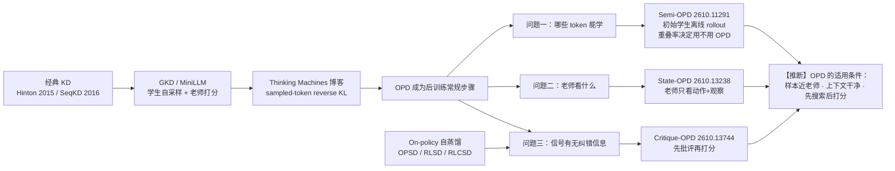

**结论先行：** On-policy distillation（OPD）有适用条件，不是免费午餐。2026 年 10 月的三篇论文各自拆掉了一个默认假设：

1. **Semi-OPD**：样本不必一直 on-policy。师生输出重叠低时，用初始学生的离线 rollout 反而更好、更快。
2. **State-OPD**：老师不该看学生之前的推理。多轮 agent 里，只给老师「动作 + 观察」，监督质量更高。
3. **Critique-conditioned self-distillation**（下文简称 Critique-OPD）：只打分的老师找不到错误。先生成批评，再打分，信号才带纠错信息。

三篇合起来指向一个判断【推断】：OPD 的「稠密 token 信号」只有在三处都对齐时才有用——样本离老师不远、老师上下文干净、老师真的做过「找错」这一步。

---

## 1. 背景：OPD 在解决什么

传统知识蒸馏在老师生成的序列上训练学生。学生推理时却走自己的轨迹。训练和推理的分布不一致，这叫 exposure bias。

OPD 的做法是反过来：学生自己采样，老师在学生轨迹的每个 token 上打分。这条线的代表工作有：

- **GKD**（Agarwal et al., ICLR 2024，[arXiv 2306.13649](https://arxiv.org/abs/2306.13649)）：在学生自生成序列上蒸馏，标题就叫「learning from self-generated mistakes」。
- **MiniLLM**（Gu et al., ICLR 2024，[arXiv 2306.08543](https://arxiv.org/abs/2306.08543)）：用 reverse KL 做 LLM 蒸馏。
- **Thinking Machines 的博客**（Lu & Thinking Machines Lab, 2025，[On-Policy Distillation](https://thinkingmachines.ai/blog/on-policy-distillation)）：把 OPD 推广成后训练里的常规步骤，用「只在学生采到的 token 上算师生 log-ratio」的近似。

Semi-OPD 论文把这个常用目标写成（[2610.11291 §2.1](https://arxiv.org/abs/2610.11291)）：

$$
\mathcal{L}_{OPD}(\theta)=\mathbb{E}_{y\sim\pi_\theta}\Big[\sum_t -A_t\log\pi_\theta(y_t\mid s_t)\Big],\quad
A_t=\log\pi_T(y_t\mid s_t)-\log\pi_\theta(y_t\mid s_t)
$$

$A_t$ 看作常数。直观上，它就是一个「每个 token 都有奖励」的 RL：老师比学生更喜欢的 token 被推高，反之被压低。

问题在于，这个公式默认了三件事：

| 默认假设 | 被哪篇挑战 |
|---|---|
| 样本越 on-policy 越好 | Semi-OPD |
| 老师的上下文 = 学生的完整历史 | State-OPD |
| 老师的 log-ratio 本身就是信用分配 | Critique-OPD |

---

## 2. 问题一：哪些 token 能学？——Semi-OPD

> Zhao et al., *When Do We Need On-Policy Distillation? Distilling on Offline Student Rollouts Is Often Better*, [arXiv 2610.11291](https://arxiv.org/abs/2610.11291)

### 方法

Semi-OPD 只在训练前用**初始学生** $\pi_0$ 采一次 rollout，整个训练复用。老师 log-prob 也只算一次。目标函数和 OPD 完全一样；学生的 log-prob（所以 $A_t$）每步用当前参数重算。

它用一个指标判断师生是否对齐：在初始学生 rollout 的每个位置，比较师生 top-K token 集合的交集比例（Overlap@K，默认 K=64）。

### 关键结果（均核对原文）

- 17 对师生，参数 1.5B 到 235B，覆盖 Qwen3、DeepSeek-R1-Distill、Nemotron-Cascade-2 三个家族。Semi-OPD 在 14 对上胜过 OPD，最高 +13.6% 准确率，最高 11.4× 训练加速。其余 3 对差距 0.1%–2.6%。
- 增益与初始 top-64 重叠率的 Pearson 相关 r = −0.73。重叠越低，Semi-OPD 越占优。
- 高重叠的例子：Nemotron-Cascade-2 对，重叠 89.3%，Semi-OPD 平均 74.1，和标准 OPD 持平，比最好的基线低 0.7。
- 低重叠的例子：Qwen3-1.7B ← Qwen3-4B-Instruct-2507，重叠 62.5%。标准 OPD 平均 26.2，Semi-OPD 39.8（表 1，avg@32）。
- 训练成本（表 4，H100 GPU 时/100 步）：同一对上 OPD 56.8，Semi-OPD 5.0。

### 作者的解释

有效蒸馏要同时对**学生**和**老师**都 on-policy。OPD 只照顾了前者。低重叠时，OPD 的 rollout 越训越长（最后 10 步比 Semi-OPD 长 7%–113%，16 对里 15 对如此），后段离老师分布越来越远，老师在那里的打分不可靠。

两个对照把这件事钉住了：

- 把缓存换成**老师** rollout，效果不如 Semi-OPD。说明学生 on-policy 仍然重要。
- 只在前 1/4 段训练（总 token 数不变）会明显变差。说明不能靠截断解决，要覆盖完整推理阶段。

### 边界

- 学生得够强。从 base 模型出发，Semi-OPD 输给 OPD（图 11）。
- 论文发现「先在老师 rollout 上 SFT 一轮，再 Semi-OPD」不如直接 Semi-OPD。注意它的学生已经是指令微调模型。

【推断】Semi-OPD 回答的其实是「哪些 token 能学」：样本要在学生分布里，也要在老师认得的区域里。重叠率是这个条件的一个便宜代理。

---

## 3. 问题二：老师看什么？——State-OPD

> Zhang et al.（Alibaba），*State-OPD: State-Grounded On-Policy Distillation for Multi-Turn Agents*, [arXiv 2610.13238](https://arxiv.org/abs/2610.13238)

### 问题设定

多轮 agent 里，每轮学生输出「推理 $z_t$ + 动作 $a_t$」，环境返回观察 $o_{t+1}$。标准 OPD 让老师看学生的完整历史 $h_t$，其中包含学生之前所有的推理。

作者定义**交互状态** $s_t$：任务、已执行动作、返回观察，**去掉**之前的学生推理。命题 1 证明：在动作只通过 $a_t$ 影响环境的假设下，$s_t$ 保留了 $h_t$ 关于环境状态的全部信息。所以之前的推理对环境没有信息量，却会进入老师上下文。

### 两个诊断

- **旧推理污染老师。** 在 ALFWorld 匹配状态上，让 Qwen3-32B 老师接着做任务。看 $s_t$ 比看 $h_t$ 成功率更高。Qwen3-4B 学生的状态上，增益从早段 +0.78 点涨到后段 +20.31 点（表 3）。在 $h_t$ 条件下，sampled reverse KL 随轮数下降；换成 $s_t$ 后趋势反转。作者的解读：旧推理把老师目标拉向学生自己的分布，KL 变小，指导变弱。
- **当前推理决定动作多样性。** 同一状态采 16 个回复：固定推理只重采动作，88.5% 的状态只得到 1 个动作；整段重采，这个比例降到 44.3%。

### 方法

1. **状态接地监督**：学生仍看完整 $h_t$ 生成，老师只看 $s_t$ 打分。
2. **状态中心的回复分配**：按学生 token 熵挑出高熵状态，在那里多采完整回复，总预算与 4 rollout 基线近似持平（$\beta=2$，每个选中状态多采 6 个）。

### 关键结果（均核对原文）

- 三个基准：ALFWorld、ScienceWorld、WebShop。老师 Qwen3-32B。
- Qwen3-4B 学生：宏平均成功率 31.74%，最强基线（Vanilla OPD）26.07%。Qwen3-1.7B：20.76%，组内第一。
- ALFWorld Seen 上 4B 学生 43.39%，**超过** 32B 老师的 38.39%。
- 消融（ALFWorld 平均）：Vanilla 32.42 → 只加状态接地 41.73 → 两者都加 44.55。状态接地贡献最大。
- 失败动作循环：第 200 步，连续 8 次重复同一失败动作的比例，State-OPD 0.07%，Vanilla OPD 4.29%。
- 局限：每个配置只有一个训练 seed（42）；ScienceWorld 上的增益置信区间多数跨 0（表 8）。

【推断】State-OPD 回答的是「老师看什么」。老师需要的是事实（动作和观察），不是学生的叙述。这和 Semi-OPD 的结论同构：老师的条件分布一旦被学生的东西带偏，打分就不再是好老师的打分。

---

## 4. 问题三：老师的信号里有没有纠错信息？——Critique-OPD

> Maniparambil et al.（Fin.ai / Dublin City University），*A Privileged Teacher That Only Scores Cannot Search: Critique-Conditioned On-Policy Self-Distillation for Reasoning*, [arXiv 2610.13744](https://arxiv.org/abs/2610.13744)

说明：这篇研究的是**自蒸馏**（OPSD）——同一个模型，带特权信息（参考答案）当老师，给自己的 rollout 打分。「Critique-OPD」是本文的简称，论文自己的说法是 critique-conditioned self-distillation。

### 诊断：只打分的老师找不到错

作者用金标错误片段（LLM 标注 + 双评审）测两个信号：

- **定位**：老师分布在错误处是否变化更大（content KL）。
- **纠错**：老师是否压低学生错误 token 的概率（Δlog p，负值为纠错）。

结论：参考答案条件下，两个信号都不达标。Qwen3-1.7B、Olmo-3-7B-Think、Olmo-3-32B-Think 三个学生，没有一个设置同时满足「定位为正、纠错为负且显著」（表 1）。连整条轨迹平均都分不清对错：题内 AUC 的 12 个置信区间全部包含 0.5（表 10）。

作者的论点：**找错本身是一个搜索问题**。打分只是在给定前缀上算下一个 token 分布，从没被要求去对照参考找错。

### 方法：先批评，再打分

同一个模型、同样的参考答案，先生成一段批评（逐条「原文引用 + 错因」），再把批评放进老师上下文打分。

- 批评条件下，oracle 批评（gpt-5.2）在所有设置上都满足定位和纠错标准。例如 Qwen3-1.7B 在 DeepMath L5-7 上：定位 +0.99，纠错 −0.90。
- 引用负责「指哪里」，错因负责「怎么改」（表 4 消融）。
- 被释放的概率流向自我纠正词。K&K 上，错误处 argmax 变成 Wait/But 等标记的比例：参考条件 4.9%（对照 4.9%），批评条件 23.9%（对照 7.7%）。

### 训练证据（规模很小，作者自己承认）

Olmo-3-7B-Instruct，320 道 K&K 题，100 步（附录 A.2，表 6），OOD 准确率：

| 方法 | OOD |
|---|---|
| base | 0.403 |
| GRPO | 0.509 |
| GRPO + 批评（gpt-5-mini） | 0.564 |
| RLCSD（参考条件自蒸馏） | 0.567 |
| RLCSD + 批评（gpt-5-mini） | 0.606 |
| RLCSD + 自我批评 | 0.593 |

冷启动小实验（附录 A.1）：4 道 GRPO 64 次采样都做不出的题，GRPO 对照只靠运气解出 1 道；批评条件那一组解出了其余 3 道里的 2 道。单 seed。

额外开销：学生自评占步时 6%，API 评审约 21%–22%（表 7）。

局限：所有批评都是在有参考答案的情况下写的。它证明的是「批评能把特权信息转成可用形式」，不是「模型能自己纠错」。

【推断】Critique-OPD 回答的是「信号里有没有纠错信息」。答案是：稠密 ≠ 信用分配。要先搜索，再打分。

---

## 5. 对照表

| | Semi-OPD | State-OPD | Critique-OPD |
|---|---|---|---|
| 诊断问题 | 哪些 token 能学 | 老师看什么 | 信号里有无纠错信息 |
| 被打破的默认 | 样本越 on-policy 越好 | 老师看学生全历史 | log-ratio 即信用分配 |
| 改动的位置 | rollout 来源（初始学生，离线） | 老师上下文（去掉旧推理）+ 采样分配 | 老师上下文（加入生成的批评） |
| 场景 | 数学推理，单轮 | 多轮 agent | 逻辑/数学推理，自蒸馏 |
| 核心诊断量 | top-64 重叠率，r = −0.73 | 匹配状态续跑成功率 | 金标错误处的 error-span Z |
| 代表数字 | 14/17 对胜出；最高 11.4× 加速 | 4B 宏平均 26.07% → 31.74% | OOD 0.567 → 0.606 |
| 主要局限 | 需要够强的初始学生 | 单 seed；ScienceWorld 增益不显著 | 320 题 / 100 步；批评依赖参考答案 |
| 算力方向 | 更省 | 预算近似持平 | 多一次生成 |

---

## 6. 脉络图

---

## 7. 开放问题

**SFT 预热和 OPD 冲突吗？** Semi-OPD 发现，先在老师 rollout 上 SFT 一轮再 Semi-OPD，不如直接 Semi-OPD。但它的学生已是指令微调模型；从 base 出发时 Semi-OPD 本身就输给 OPD。【推断】「要不要 SFT 预热」可能取决于初始学生强弱，而不是一条通用规则。三篇都没有回答这个问题，需要同设定的对照。

**RL 冷启动能靠 OPD 信号解决吗？** GRPO 在全错组上优势为 0，没有梯度。Critique-OPD 给出了一个小规模正面证据：批评条件信号可以当全错组的优势。【推断】但它依赖参考答案。在没有参考答案的开放任务上，批评从哪来，仍未解决。

**重叠率能否在训练中动态使用？** Semi-OPD 只用初始重叠率做一次性选择。作者还观察到，从 Semi-OPD 切到 OPD 后，低重叠对会收敛到「由在线 rollout 分布决定的平衡点」。【推断】按重叠率在训练中切换样本来源，是一个自然的下一步。

**状态接地能推广到单轮推理吗？** 单轮推理没有「动作–观察」。【推断】对应的版本可能是：只给老师已验证的中间结论，不给学生的原始思维链。这和 Critique-OPD「给老师结构化信息而非原始轨迹」是同一个方向。

**扩散/视频模型有没有同样的问题？** 【推断】扩散蒸馏里也有「学生样本离老师多远时还该 on-policy」的问题。Semi-OPD 的重叠率思路能否迁移到连续空间，值得一试。

---

## 参考

- Semi-OPD：[arXiv 2610.11291](https://arxiv.org/abs/2610.11291)
- State-OPD：[arXiv 2610.13238](https://arxiv.org/abs/2610.13238)
- Critique-conditioned self-distillation：[arXiv 2610.13744](https://arxiv.org/abs/2610.13744)
- GKD：[arXiv 2306.13649](https://arxiv.org/abs/2306.13649)
- MiniLLM：[arXiv 2306.08543](https://arxiv.org/abs/2306.08543)
- Thinking Machines Lab, On-Policy Distillation：<https://thinkingmachines.ai/blog/on-policy-distillation>

*本文数字均取自论文 arXiv 原文（2026-10-13 核对）。标【推断】的内容是作者判断，不是论文结论。*
